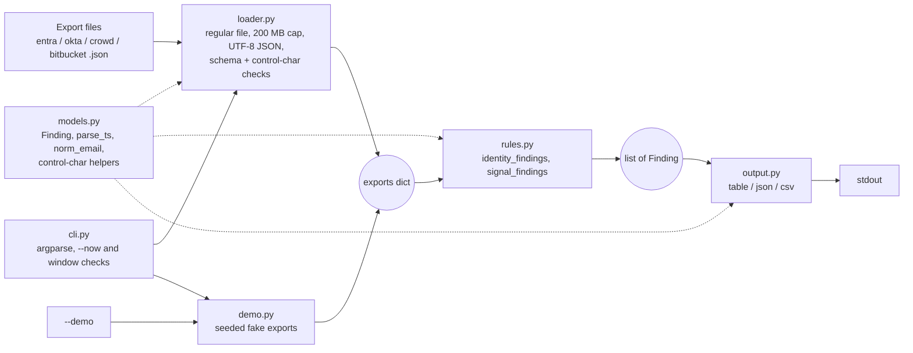

# linchpin

CLI-only, read-only identity review across Microsoft Entra ID, Okta, Atlassian Crowd and
Bitbucket: correlates user exports by email and flags identity-hygiene and insider-risk
signals. Every flag is explainable, with a rule id, a reason and the evidence fields behind it.

[![CI][ci-badge]][ci] [![License: MIT][lic-badge]](LICENSE) [![Python][py-badge]](pyproject.toml)
[![Release][rel-badge]][rel]

[ci-badge]: https://github.com/chriswayneh/linchpin/actions/workflows/ci.yml/badge.svg?branch=main
[ci]: https://github.com/chriswayneh/linchpin/actions/workflows/ci.yml
[lic-badge]: https://img.shields.io/badge/license-MIT-blue.svg
[py-badge]: https://img.shields.io/badge/python-3.10%2B-blue.svg
[rel-badge]: https://img.shields.io/badge/release-v0.1.2-blue.svg
[rel]: https://github.com/chriswayneh/linchpin/releases/tag/v0.1.2

linchpin never calls an identity provider or application. It reads exported JSON files (or
built-in `--demo` data) and prints findings. It has no runtime dependencies.

## Install

```bash
git clone https://github.com/chriswayneh/linchpin.git
cd linchpin
pip install .            # or: pip install -e '.[dev]' for development
linchpin --version
```

Requires Python 3.10 or newer.

## Quick start

```bash
linchpin identity --demo                 # identity hygiene, table output
linchpin signals --demo --format json    # insider-risk signals as JSON
linchpin identity --data ./exports --format csv > identity.csv
```

`--demo` uses seeded fake users on `example.com` across all four sources, so no tenant or
export is needed.

## Commands

| Command | What it does |
|---|---|
| `identity` | Identity hygiene: rules ID001 to ID004 |
| `signals` | Insider-risk signals: rules SIG001 and SIG002 |

### Flags for both commands

| Flag | Default | Meaning |
|---|---|---|
| `--demo` | | Use seeded fake demo data (one of `--demo` or `--data` is required) |
| `--data DIR` | | Directory with `entra.json`, `okta.json`, `crowd.json`, `bitbucket.json` |
| `--seed N` | `42` | Demo RNG seed; same seed gives the same data |
| `--users N` | `30` | Demo user count, 7 to 300 |
| `--now TS` | demo epoch or current UTC | Reference time (ISO-8601) for all windows |
| `--format` | `table` | `table`, `json` or `csv` |

The demo epoch is `2026-10-01T15:00:00Z`. With `--data`, `--now` defaults to the current UTC
time.

### Command-specific flags

| Command | Flag | Default | Meaning |
|---|---|---|---|
| `identity` | `--stale-days N` | `90` | ID003 stale window, at least 1 |
| `signals` | `--mass-threshold N` | `10` | SIG001 distinct repos per off-hours day, at least 1 |
| `signals` | `--leaver-window-days N` | `30` | SIG002 look-back for leave dates, at least 0 |

### Input files

With `--data DIR`, missing files are treated as empty. Users are correlated by normalized
(trimmed, lowercased) email: Entra `mail`, else `userPrincipalName`; Okta `email`, else `login`.
Times are evaluated in UTC.

## Rules

| Rule | Severity | Meaning |
|---|---|---|
| ID001 | high | Active Crowd/Bitbucket account with no Entra or Okta identity (orphan) |
| ID002 | high | Disabled in Entra / non-ACTIVE in Okta but active in Crowd/Bitbucket |
| ID003 | medium | Active Entra/Okta/Crowd account with no login in `--stale-days` |
| ID004 | critical | Entra privileged or Okta admin without MFA |
| SIG001 | high | At least `--mass-threshold` distinct repos off-hours in one UTC day |
| SIG002 | critical | Bitbucket activity after a recent leave date, up to `--now` |

A null or missing Okta `status` (or Entra `accountEnabled`, Crowd/Bitbucket `active`) is treated
as unknown: it never fires ID002 as disabled, and the account is still checked by ID003.

Off-hours means a weekend, or outside 07:00–20:00 UTC. SIG002 fires only when the leave date is
within `[now - window, now]` and the activity is after the leave date and not after `now`.

Every finding has `rule_id`, `severity`, `user`, `source`, `reason` and `evidence`.
Identity findings for accounts without an email use the lowercased login, name or username,
else `(no email)`. Signals skip events and leavers with no email, so no SIG row has an empty
user.

## Architecture



| Module | Role | Imports (linchpin modules) |
|---|---|---|
| `cli.py` | Arguments, `--now` checks, runs commands, exit codes | the other five |
| `loader.py` | Reads and validates `--data` exports | `models` |
| `demo.py` | Generates deterministic fake exports | (none) |
| `models.py` | `Finding`, timestamp and email normalization, control-character helpers | (none) |
| `rules.py` | The six detection rules | `models` |
| `output.py` | Renders findings as table, JSON or CSV | `models` |

## Exit codes

| Code | Meaning |
|---|---|
| 0 | Success, with or without findings |
| 1 | Not used on purpose: only an unexpected internal error (uncaught exception) |
| 2 | Usage error (bad arguments, out-of-range flags, bad or too early `--now`), or a load error |

Load errors include a missing data directory, a non-regular file, a file over 200 MB, unreadable
files, invalid UTF-8 or JSON, nesting too deep, malformed entries, non-string or control-character
identity fields, an Okta `status` that is not a string, non-boolean MFA/privilege/active flags,
and invalid timestamps. Email syntax is not validated.
Errors are one line on stderr, without a traceback.

## Hardening

- **Control characters:** identity fields containing Unicode Cc, Cf or Cs characters (C0/C1
  controls including CSI, bidi overrides and isolates, zero-width characters, unpaired
  surrogates) are rejected on load, and the error names the code point (e.g. `U+200D`), never
  the raw character. Table and CSV output strip the same categories.
- **Bounded reads:** each export must be a regular file (`is_file()`), so directories and
  devices such as a symlink to `/dev/zero` are refused. At most 200 MB + 1 byte is read, so
  the cap does not trust `st_size`.
- **CSV formula guard:** cells whose first non-whitespace character is `=`, `+`, `-` or `@` are
  prefixed with `'`.
- **Read-only:** no network calls and no writes; output goes to stdout only.

## Development

```bash
pip install -e '.[dev]'
ruff check . && ruff format --check .
pytest            # branch coverage, enforces --cov-fail-under=85
mypy && bandit -r src && pip-audit --skip-editable
```

## More

- [ROADMAP.md](ROADMAP.md): phases v0.1 to v1.0
- [SECURITY.md](SECURITY.md): how to report a vulnerability
- [CHANGELOG.md](CHANGELOG.md): release notes
- [SPEC.md](SPEC.md): scope and principles

## License

MIT. See [LICENSE](LICENSE).
